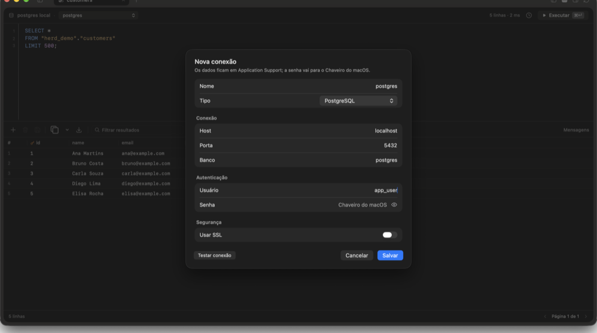

  

<h1 align="center">herd</h1>

<strong>Seus bancos de dados, com a leveza do Mac.</strong>

Explore schemas, escreva SQL com autocomplete e edite dados inline em um cliente PostgreSQL 100% nativo.

Nativo para macOS (SwiftUI + AppKit) &nbsp;·&nbsp; Interface em português &nbsp;·&nbsp; Senhas no Chaveiro

## Tudo à mão. Sem sair do fluxo.

O Herd reúne árvore de objetos, editor SQL e resultados em uma janela rápida e silenciosa. Expanda um servidor na barra lateral para navegar por bancos, schemas, tabelas, views e colunas sob demanda — identificando chaves primárias e estrangeiras de imediato.

Dê dois cliques em uma tabela para abrir seus dados paginados ou abra quantas abas de script precisar. Os atalhos seguem o padrão do macOS e do VS Code (`⌘B` para a barra lateral, `⌘J` para os resultados e `⌥⌘B` para o histórico), deixando mais espaço para o que importa.

| Para trabalhar com…     | O Herd oferece…                                                                                        |
| :---------------------- | :----------------------------------------------------------------------------------------------------- |
| A estrutura do banco    | Árvore sob demanda, filtro instantâneo (`⇧⌘F`), inspetor de DDL (`⌘I`) e wizards nativos de criação.   |
| Consultas e scripts SQL | Editor `NSTextView` com realce de sintaxe, formatação (`⇧⌥F`), snippets e autocomplete (`⌥Space`).     |
| Os dados da tabela      | Edição inline com duplo clique, adição/remoção de linhas, revisão do SQL gerado e commit em transação. |
| Rotinas de operação     | Backup e restore via `pg_dump`/`pg_restore`/`psql` e importação/exportação de CSV com log ao vivo.     |
| Segurança e privacidade | Credenciais guardadas no Chaveiro do macOS, conexões locais em JSON (`0600`) e zero telemetria.        |

## Escreva SQL, edite dados e revise antes de aplicar

O editor SQL executa o script inteiro, apenas o trecho selecionado ou o comando sob o cursor (`⌘↵`, `⇧⌘↵`, `⌥⌘↵`), com cancelamento real no servidor via `pg_cancel_backend` (`⌘.`). Quando um script retorna várias consultas, cada conjunto aparece em seu próprio painel redimensionável.

No grid de resultados, dê dois cliques em qualquer célula para editar o valor na hora, adicione novas linhas no final navegando com `Tab` e `Enter`, ou selecione intervalos inteiros com `Shift`. Antes de gravar no banco, você pode revisar os comandos `INSERT`, `UPDATE` e `DELETE` gerados e aplicá-los em uma única transação.

## Conexões seguras no Chaveiro do macOS

Cadastre servidores locais ou remotos em segundos, teste a conexão antes de salvar e ative SSL quando necessário. As configurações ficam em `Application Support` com permissão restrita ao seu usuário, enquanto as senhas são armazenadas diretamente no Chaveiro do macOS.

---

## Roadmap

**Estado:** fases 1, 2, 3, 4, 5 e 7 concluídas; fase 6 em standby; fase 8 em polimento final; fase 9 em desenvolvimento, com Safe Mode concluído e Abrir Qualquer Coisa ainda em construção; fase 10 (diagrama ER) futura.

| Fase | Escopo                                             | Status             |
| ---- | -------------------------------------------------- | ------------------ |
| 1    | Esqueleto, driver PostgreSQL, conexões e árvore    | ✅ Concluída       |
| 2    | Editor SQL, execução, cancelamento e histórico     | ✅ Concluída       |
| 3    | Autocomplete, snippets e scripts SQL               | ✅ Concluída       |
| 4    | Grid de dados, ações do editor SQL e menus nativos | ✅ Concluída       |
| 5    | Structure/DDL                                      | ✅ Concluída       |
| 6    | FreeTDS + SQL Server                               | ⏸️ Standby         |
| 7    | Backup/restore, novo banco e geração de scripts    | ✅ Concluída       |
| 8    | Polimento, acessibilidade e empacotamento          | 🚧 Polimento final |
| 9    | Safe Mode, ⌘P, console de log, processos, filtros e I/O | 🚧 Em desenvolvimento |
| 10   | Diagrama ER                                        | 🔮 Futura          |

## As 10 fases, em imagens

As capturas abaixo usam exclusivamente uma base fictícia (`herd_demo`), nomes genéricos e dados de exemplo. Nenhum banco, host, usuário ou dado de produção aparece na documentação.

### 1. Conecte com segurança e explore sem atrito

A fundação do Herd já está pronta: cliente PostgreSQL nativo, conexões protegidas pelo Chaveiro do macOS e navegação sob demanda por bancos, schemas, tabelas, views e colunas.

### 2. Consulte com a velocidade de uma ferramenta nativa

O editor combina realce de sintaxe, execução de script, seleção ou comando atual, múltiplos resultados, cancelamento no servidor e histórico por conexão e banco.

### 3. Escreva menos SQL repetitivo

Autocomplete contextual, aliases, schemas, snippets e scripts prontos de `SELECT`, `INSERT`, `UPDATE`, `DELETE` e DDL aceleram tarefas recorrentes sem tirar as mãos do teclado. A captura mostra o editor que recebe essas sugestões e abre os scripts gerados.

### 4. Edite dados com controle

O grid oferece paginação, ordenação e filtro no servidor, seleção em lote, cópia em TSV, exportação CSV e edição inline. Antes do commit, o Herd apresenta o SQL gerado e aplica tudo em uma única transação.

### 5. Entenda e evolua a estrutura

Structure/DDL reúne colunas, índices e constraints, gera o `CREATE TABLE` completo e prepara alterações com preview. Wizards nativos cobrem tabela, schema, coluna, índice, regra, trigger e política RLS, sempre com revisão antes da execução.

### 6. SQL Server — em standby

A integração via FreeTDS continua no roadmap. Como ainda não existe uma experiência concluída para demonstrar, esta fase não usa captura de tela nem antecipa uma interface que o produto ainda não entrega.

### 7. Operações de banco sem sair do Herd

Backup e restore PostgreSQL usam `pg_dump`, `pg_restore` e `psql`, com progresso e log ao vivo. A fase também entrega criação de banco pela interface e geração de scripts SQL pelo menu da tabela.

### 8. Uma experiência feita para o Mac

Tema claro/escuro, Liquid Glass, menus de contexto nativos, estados vazios e de erro, atalhos completos e distribuição em `.app`, `.dmg` e `.zip` fazem o Herd se comportar como parte do macOS — não como uma página web empacotada.

### 9. Segurança diária já entregue; produtividade em evolução

O Safe Mode já permite escolher entre execução silenciosa, confirmação antes de comandos sensíveis e proteção por senha ou Touch ID, além de marcar conexões de produção. **Abrir Qualquer Coisa (`⌘P`) ainda está em desenvolvimento**, assim como console, processos ao vivo e a próxima rodada de filtros e importação/exportação.

### 10. Diagrama ER — futura

O diagrama entidade-relacionamento será construído sobre as PKs e FKs que o Herd já descobre. A fase ainda não tem interface pronta; por isso, não há mockup apresentado como produto concluído.

## Plano detalhado por fases

### Fase 1 — Esqueleto, driver PostgreSQL e árvore ✅

- [x] Pacote SwiftPM com `HerdCore` (sem UI), `HerdDB` (app) e testes
- [x] Janela nativa com `NavigationSplitView`, sidebar estilo pgAdmin e abas de consulta
- [x] Tema claro/escuro automático e componentes 100% do sistema
- [x] Protocolo `DatabaseDriver` async + `SQLDialect` (quoting, `LIMIT`/`TOP`)
- [x] `PostgresDriver` com `postgres-nio` e pool por conexão
- [x] Descoberta de bancos, schemas, tabelas, views, colunas, PKs e FKs
- [x] Árvore conexão → banco → schema → tabela/view → coluna, com carga sob demanda
- [x] Filtro de objetos, seleção e menu de contexto nativo por tipo de nó
- [x] Gerenciador de conexões: JSON em Application Support, senha no Chaveiro, teste de conexão

### Fase 2 — Aba de consulta ✅

- [x] Editor SQL em `NSTextView`/TextKit 1 com placeholder de atalho
- [x] Realce de sintaxe próprio (keywords, strings, números, comentários e parâmetros)
- [x] Números de linha, indentação automática, Tab em 4 espaços, sem smart quotes/spell check
- [x] Separação de scripts em comandos e ranges (`SQLStatementSplitter`)
- [x] Execução sequencial de vários comandos; erro indica "Comando X de Y"
- [x] `⌘↵` executa script ou seleção; `⌥⌘↵` executa seleção ou comando sob o cursor
- [x] `⇧⌘↵` executa o script inteiro ignorando a seleção
- [x] Cancelamento real via `pg_cancel_backend` em conexão reservada do pool
- [x] Resultados com todos os conjuntos retornados, tempo, contagem de linhas e erros
- [x] Abas com banco, estado de execução e menu de contexto (fechar/copiar SQL)
- [x] Histórico por conexão/banco no inspetor: horário, duração, linhas, erro, reuso e limpeza
- [x] Testes de splitter (21), tokenizer (11), histórico (7), dialeto (6), conexões (2)
      e integração Postgres (7)

### Fase 3 — Autocomplete, snippets e scripts SQL ✅

- [x] Parser leve de contexto (`FROM`/`JOIN`, `alias.`, `schema.`)
- [x] Popup de sugestões com schemas, tabelas, colunas e palavras-chave SQL, filtrável e navegável por teclado
- [x] Snippets `sel`, `ins`, `upd`, `del`, `selt`
- [x] Menu "Scripts SQL" no nó da tabela: SELECT, SELECT 10 linhas, INSERT, UPDATE, DELETE e CREATE (DDL)
- [x] Consulta pronta aberta em nova aba com o SQL preenchido
- [x] Catálogo por banco em três consultas, cacheado por conexão/banco e invalidado ao atualizar a árvore
- [x] Popup nativo não ativante: `⌥Space`, `⌃Space` ou F5 abre, setas navegam, Return/Tab inserem, Esc fecha
- [x] Validar o popup visualmente em claro/escuro, perto das bordas da janela e com o editor redimensionado
- [x] 20 testes de autocomplete (contexto, alias, schema, filtro, ordenação e snippets);
      catálogo coberto no teste de integração do Postgres (74 testes no total)

### Fase 4 — Grid de dados, editor SQL e menus nativos ✅

- [x] Largura das colunas ajustável arrastando a borda do cabeçalho
- [x] Paginação local de 100 linhas e filtro local sobre o resultado carregado
- [x] Seleção de linhas (individual, `⌘` e intervalo em lote com `Shift`) e cópia em TSV, com opção de incluir cabeçalhos e exportar CSV
- [x] Alternância entre dados e mensagens da execução
- [x] Adicionar nova linha inline no final do grid com preenchimento célula a célula (`Tab` / `⇧Tab` / `Return`)
- [x] Grid virtualizado (`LazyVStack`) com linhas alternadas e cabeçalho nativo (com indicadores de PK e FK)
- [x] Paginação de 500 linhas com navegação ao abrir uma tabela pela árvore
- [x] Ordenação por coluna e filtro de texto executados no servidor ao navegar pela tabela
- [x] Edição inline com duplo clique na célula e destaque das células alteradas, inseridas e marcadas para remoção
- [x] Geração de `INSERT`, `UPDATE ... WHERE <pk>` e `DELETE ... WHERE <pk>` e sheet "Revisar alterações SQL"
- [x] Execução em transação (`BEGIN ... COMMIT`), salvar e descartar alterações
- [x] FK clicável para abrir a linha referenciada em nova aba
- [x] Atalhos e ações rápidas de edição e busca no editor e no grid

#### Ações rápidas do script

- [x] Adicionar ao editor SQL um menu de contexto com **Buscar**, **Substituir** e **Ir para linha/coluna**, com foco no campo correto, navegação entre ocorrências e seleção do destino; os mesmos comandos devem funcionar pelo teclado
- [x] Adicionar **Indentar seleção**, **Remover indentação**, **Comentar/descomentar**, **Alternar maiúsculas/minúsculas da seleção**, **Limpar consulta** e **Formatar SQL** ao menu de contexto; operações de edição devem integrar o desfazer/refazer do `NSTextView`
- [x] Definir a formatação SQL para seleção ou documento inteiro, preservando conteúdo de strings e comentários, respeitando o dialeto da conexão e mantendo seleção/cursor em posição útil após a alteração
- [x] Habilitar ações conforme o estado: busca, navegação e formatação exigem script ativo; ações sobre seleção exigem seleção; limpar consulta exige texto; comandos de edição ficam indisponíveis quando o editor não puder ser alterado

#### Barra de menus do macOS

- [x] Reorganizar **Arquivo** com **Novo ▸** (Script, Conexão e objetos do banco aplicáveis ao contexto), **Abrir arquivo SQL…**, ações de salvar e fechamento de aba/janela; abrir `.sql` em nova aba vinculada à conexão/banco escolhido, com tratamento de codificação e alterações não salvas
- [x] Em **Novo ▸**, oferecer no contexto de banco/schema/tabela os modelos de criação disponíveis, como Tabela, Schema, Coluna, Índice, Regra, Trigger e Política RLS; abrir o DDL em um script para revisão, respeitar o dialeto e ocultar ou desabilitar itens sem contexto ou suporte, sem executar DDL automaticamente
- [x] Integrar **Editar** às ações rápidas do SQL quando houver script ativo, além dos comandos nativos Desfazer/Refazer, Recortar, Copiar, Colar e Selecionar Tudo; estado habilitado e atalhos devem acompanhar o foco real do editor para não interferir nos campos de busca e no grid
- [x] Remover **Visualizar > Mostrar Barra de Abas** do menu de sistema, pois a opção conflita com a barra de abas própria do app; manter a navegação entre abas funcionando e conferir que o item não reaparece ao trocar de janela/aba

### Fase 5 — Structure/DDL ✅

- [x] Aba/Sheet Structure (`TableStructureSheet`) com colunas, índices e constraints/chaves estrangeiras
- [x] DDL gerado (`CREATE TABLE`, índices, constraints)
- [x] Alterações via preview e execução de `ALTER TABLE` + wizards nativos (`CreateTableSheet`, `CreateSchemaSheet`, `CreateTableSubObjectSheet`, `DropObjectSheet`)
- [x] Atalho `⌘I`

### Fase 6 — SQL Server ⏸️ (Standby)

- [ ] FreeTDS (dblib) compilado como xcframework e embutido no `.app`
- [ ] `MSSQLDriver` async com pool e cancelamento
- [ ] Dialeto `[x]`/`TOP` e catálogos do SQL Server
- [ ] Paridade: árvore, abas, execução, resultados e histórico
- [ ] Testes contra SQL Server em Docker

### Fase 7 — Backup, restore, novo banco e scripts ✅

- [x] Backup/restore PostgreSQL com `pg_dump`/`pg_restore`/`psql` (`.dump` e `.sql`), progresso e log na aba **Processos**
- [ ] Backup/restore SQL Server via `BACKUP DATABASE`/`RESTORE DATABASE` (em standby junto com a Fase 6)
- [x] Novo banco pela interface (`CreateDatabaseSheet` / `⌥⌘D`)
- [x] Gerar script CREATE/INSERT/UPDATE/DELETE/SELECT pelo menu da tabela
- [x] Copiar nome do objeto (`⌥⌘C`) e atualizar nó (`⌘R`)

### Fase 8 — Polimento, escala e empacotamento 🚧

- [x] Ícone do app claro/escuro e ícones IconMCP na interface (com alternância outline/filled quando ativo)
- [x] Barra de título compacta e janela com visual nativo (liquid glass)
- [x] Menus de contexto 100% nativos, sem menus desenhados à mão
- [x] `scripts/build-app.sh` e `scripts/package-release.sh` com bundle `.app`, `.dmg`, `.zip`, ícones e assinatura ad-hoc
- [x] Estados vazios, de erro e de carregamento definitivos em todas as telas
- [x] Atalhos completos (`⌘B`, `⌥⌘B`, `⌘J`, `⌘E`, `⌘I`, `⌘F`, `⇧⌘F`, `⌥⌘F`, `⌃G`, `⇧⌥F`, `⌘/`, `⌘1…9`, `⌥⌘N`, `⌥⌘S`, `⌥⌘D`, `⇧⌘B/R`)
- [ ] Streaming sob demanda / cursores para resultados de scripts livres acima de 20 000 linhas em memória e unificação da paginação local (100 linhas) com a paginação de servidor (500 linhas)
- [ ] Resolver colunas de subconsultas e CTEs complexas no motor de autocomplete
- [ ] Paginação e busca persistida no histórico de consultas além do limite atual de 200 entradas por conexão/banco
- [ ] Revisão de acessibilidade
- [ ] Notarização e distribuição

### Fase 9 — Produtividade e segurança no dia a dia 🚧 (Em desenvolvimento)

Itens inspirados na documentação do TablePlus, em ordem de prioridade. Cada item é independente e cabe na arquitetura atual (sidebar, painel inferior, aba Processos, grid e editor).

#### 9.1 Safe Mode por conexão (prioridade 1)

- [x] Campo "nível de segurança" no formulário de conexão: **Silencioso** (padrão), **Alerta** (confirma antes de executar) e **Seguro** (pede a senha da conexão)
- [x] Variantes "2" de Alerta e Seguro: `SELECT`, `EXPLAIN` e `SHOW` não pedem confirmação
- [x] Alterar o nível pela barra de ferramentas da aba; em Seguro, a troca exige senha ou Touch ID
- [x] Preferência "nível padrão para novas conexões" e "desbloquear com Touch ID"
- [x] A confirmação vale para o editor SQL, para o commit do grid ("Revisar alterações SQL"), para DDL dos wizards e para importação
- [x] Sinal visual de conexão de produção (cor na aba e na barra de título), além do indicador de Safe Mode

#### 9.2 Abrir Qualquer Coisa — `⌘P` (prioridade 2)

- [x] Paleta de busca fuzzy sobre bancos, schemas, tabelas, views, views materializadas, funções/procedures, consultas recentes (as favoritas ficam na 9.5) e ações do app
- [x] `Return` abre o item; `⌘↵` abre a tabela em nova aba; `↑`/`↓` (e `⌃P`/`⌃N`) navegam; `Tab` completa; `Esc` limpa e, no segundo toque, fecha
- [x] Prefixo `^` (início do nome), sufixo `$` (fim) e os dois juntos (nome exato)
- [x] Listar funções e procedures na árvore de objetos, pois a busca precisa alcançá-las
- [x] Ações com atalho: Abrir Conexão (`⇧⌘K`), Abrir Banco (`⌘K`), Backup, Restore, Cancelar Consultas, Configurações

#### 9.3 Console de log — `⌃⌘C` (prioridade 3)

- [x] Painel inferior com todas as consultas enviadas ao servidor, inclusive as internas (catálogo, paginação, commit do grid), com horário
- [x] Limite de 1.000 entradas, realce de sintaxe opcional, botão "Limpar" e substituição de consultas muito grandes por uma nota resumida
- [x] Separado do histórico, que continua guardando apenas o que o usuário executa

#### 9.4 Processos ao vivo e cancelamento por sessão (prioridade 4)

- [ ] Aba **Processos** lista as sessões de `pg_stat_activity` (usuário, banco, estado, duração, consulta), atualizada sob demanda ou por intervalo
- [ ] Ações **Cancelar** (`pg_cancel_backend`) e **Encerrar** (`pg_terminate_backend`) com confirmação
- [ ] O botão Cancelar do editor continua cancelando a própria execução; `⌘.` mantém o comportamento atual
- [ ] Respeitar permissões: sessões de outros usuários exigem papel adequado, com mensagem clara quando negado

#### 9.5 Lacunas do editor, filtros e importação/exportação (prioridade 5)

Comparação com as páginas Editor Basics, Filter e Import & Export do TablePlus.

**Editor SQL**

- [x] Fechamento automático de `'` e `"`, pulando a aspa de fechamento existente e envolvendo a seleção
- [ ] Limite de linhas ao lado do botão Executar: Sem limite ou de 100 a 500.000, aplicado a `SELECT` sem `LIMIT` e salvo por conexão
- [ ] Alternar comentário em bloco (`⌥⌘/`), além do comentário de linha atual
- [ ] Dobrar/expandir trechos pela calha (instruções e linhas indentadas), lembrando as dobras em arquivos salvos
- [ ] Executar padrão configurável (executar atual ou executar tudo) no menu do botão Executar
- [ ] Consultas favoritas: "Adicionar às consultas" pelo menu do botão ou do contexto de uma seleção

**Filtros do grid**

- [ ] Barra de filtros estruturados (coluna, operador, valor) ao abrir com `⌘F` quando o foco está no grid, com **SQL bruto** como opção de coluna
- [ ] Operadores: `=`, `<>`, `<`, `>`, `<=`, `>=`, `IN`, `NOT IN`, `IS NULL`, `IS NOT NULL`, `BETWEEN`, `NOT BETWEEN`, `LIKE`, `ILIKE`, Contém, Não contém, Começa com, Termina com
- [ ] Vários filtros (adicionar e remover com `⌘I` e `⇧⌘I`), marcação individual, combinação com `AND` e opção de aplicar com `OR`
- [ ] Botão **SQL** para ver o `WHERE` gerado; **Limpar**; `Esc` oculta a barra
- [ ] Filtro rápido no menu da célula (= valor, Contém, Começa com, `IN`, `IS NULL`) e "Filtrar por esta coluna" no cabeçalho
- [ ] Filtro de colunas (`⌥⌘F`) e "Ocultar esta coluna / Mostrar todas" no cabeçalho
- [ ] Preferências: coluna, operador e estado padrão (lembrar o último estado por tabela, sempre mostrar ou sempre ocultar) e ordenação padrão da tabela

**Importação e exportação**

- [ ] Importar **JSON** e **dump SQL**, além do CSV atual
- [ ] Assistente de CSV com pré-visualização das 100 primeiras linhas, delimitador, aspas, codificação, "primeira linha é cabeçalho" e mapeamento por coluna (incluindo "Não importar")
- [ ] Opção de "Criar nova tabela" na importação, com detecção de tipos
- [ ] Estratégia ao inserir: parar no erro ou atualizar em conflito (`ON CONFLICT DO UPDATE`)
- [ ] Exportar **JSON**, **SQL** (estrutura, `DROP` e dados, com Gzip opcional) e **Excel (`.xlsx`)**, além do CSV atual
- [ ] Opções de CSV: delimitador, aspas, quebra de linha, separador decimal, NULL como vazio e cabeçalho na primeira linha
- [ ] Exportar várias tabelas de uma vez (`⇧⌘E`), com nomes de arquivo personalizáveis (conexão, banco, tabela, data) e exportação de apenas as colunas selecionadas
- [ ] Importação e exportação em segundo plano, com progresso e "Abrir pasta" ao terminar

### Fase 10 — Diagrama ER 🔮 (Futura)

- [ ] Diagrama entidade-relacionamento de um schema ou banco, gerado a partir das chaves estrangeiras que o Herd já descobre
- [ ] Tabelas com colunas, indicadores de PK/FK e linhas de relacionamento; navegar por zoom e arraste
- [ ] Abrir a tabela ou a estrutura (`⌘I`) a partir do diagrama
- [ ] Exportar o diagrama como imagem
- [ ] Ação "Diagrama" disponível em Abrir Qualquer Coisa (`⌘P`)

## Atalhos

| Atalho                                | Ação                                                                                 |
| ------------------------------------- | ------------------------------------------------------------------------------------ |
| `⌘↵`                                  | Executar o script ou a seleção                                                       |
| `⇧⌘↵`                                 | Executar o script inteiro, ignorando a seleção                                       |
| `⌥⌘↵`                                 | Executar a seleção ou o comando sob o cursor                                         |
| `⌘.`                                  | Cancelar a execução                                                                  |
| `⌘T` / `⌥⌘T`                          | Novo script / Fechar outras abas                                                     |
| `⌘W` / `⇧⌘W`                          | Fechar aba (ou janela) / Fechar todas as abas                                        |
| `⌘1` a `⌘9`                           | Alternar entre abas abertas (`⌘9` vai para a última aba)                             |
| `⇧⌘N`                                 | Nova conexão                                                                         |
| `⌘O`                                  | Abrir arquivo SQL                                                                    |
| `⌘P`                                  | Abrir Qualquer Coisa (busca fuzzy em objetos, bancos e ações)                        |
| `⌘K` / `⇧⌘K`                          | Abrir banco / Abrir conexão                                                          |
| `⌘S` / `⇧⌘S`                          | Salvar / salvar como arquivo SQL                                                     |
| `⌘F`                                  | Buscar no editor SQL (ou filtrar objetos na sidebar quando o editor não está focado) |
| `⌥⌘F`                                 | Substituir no editor SQL                                                             |
| `⇧⌘F`                                 | Filtrar objetos na barra lateral                                                     |
| `⌃G`                                  | Ir para linha/coluna no editor SQL                                                   |
| `⌘/`                                  | Comentar ou descomentar linhas                                                       |
| `⇧⌥F`                                 | Formatar SQL                                                                         |
| `⌘]` / `⌘[` (ou `Tab` / `⇧Tab`)       | Indentar / remover indentação da seleção                                             |
| `⌃⇧U`                                 | Alternar maiúsculas/minúsculas da seleção                                            |
| `⌥Space`, `⌃Space` ou `F5`            | Abrir o autocomplete no cursor                                                       |
| `↑` `↓` / `Return` ou `Tab` / `Esc`   | Navegar / inserir / fechar o autocomplete                                            |
| `⌘B`                                  | Alternar barra lateral (padrão VS Code)                                              |
| `⌥⌘B`                                 | Alternar inspetor de histórico (padrão VS Code)                                      |
| `⌘J`                                  | Alternar painel inferior de resultados (padrão VS Code)                              |
| `⌃⌘C`                                 | Alternar console de log (consultas enviadas ao servidor)                             |
| `⌘I`                                  | Estrutura / DDL da tabela selecionada                                                |
| `⌘R`                                  | Atualizar árvore / nó selecionado                                                    |
| `⌥⌘D` / `⌥⌘N` / `⌥⌘S`                 | Criar Banco de dados / Tabela / Schema (wizards nativos)                             |
| `⌥⌘K` / `⌥⌘I` / `⌥⌘U` / `⌥⌘G` / `⌥⌘Y` | Criar Coluna / Índice / Regra / Trigger / Política RLS                               |
| `⌘⌫` / `⌥⌘⌫`                          | Excluir objeto / Excluir em cascata (com confirmação digitando o nome)               |
| `⇧⌘B` / `⇧⌘R`                         | Backup / Restore do banco ou tabela                                                  |
| `⇧⌘I` / `⇧⌘E`                         | Importar / Exportar CSV da tabela                                                    |
| `⌥⌘P`                                 | Ver aba de Processos                                                                 |
| `⌥⇧⌘1` a `⌥⇧⌘6`                       | Scripts SQL: SELECT, SELECT 10, INSERT, UPDATE, DELETE, CREATE (DDL)                 |
