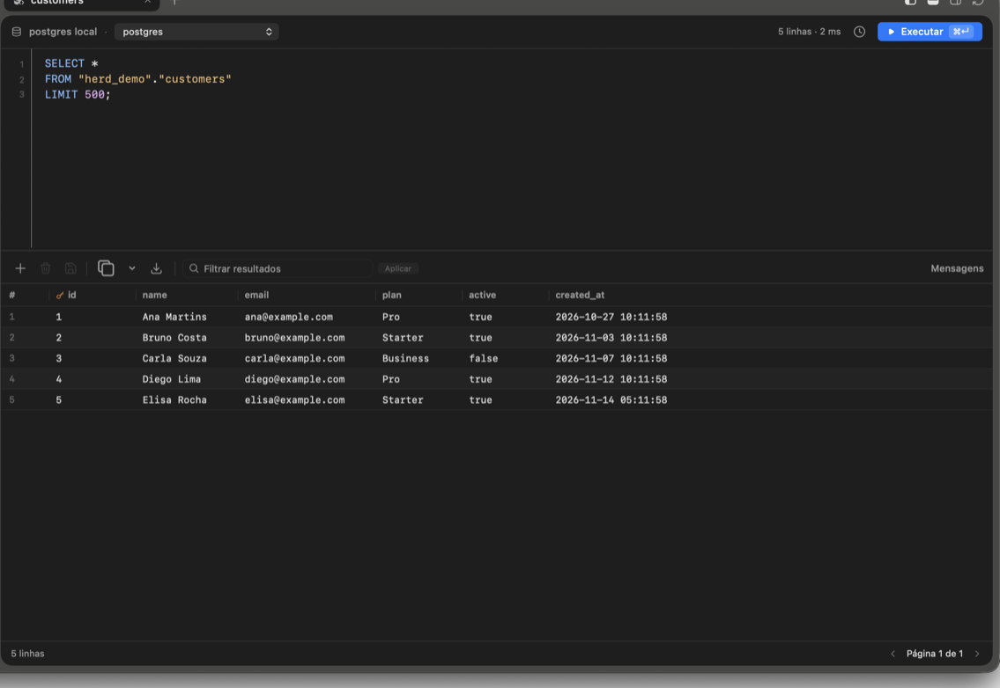

<p align="center">
  
</p>

<h1 align="center">herd</h1>

<p align="center"><strong>Seus bancos de dados, com a leveza do Mac.</strong></p>

<p align="center">
  Um cliente PostgreSQL e SQL Server 100% nativo, rápido e silencioso.<br>
  Explore schemas, escreva SQL, edite dados e faça backup — tudo na mesma janela.
</p>

<p align="center">
  macOS nativo (SwiftUI + AppKit) &nbsp;·&nbsp; Interface em português<br>
  PostgreSQL + SQL Server &nbsp;·&nbsp; Senhas no Chaveiro &nbsp;·&nbsp; Sem telemetria
</p>

<p align="center">
  
</p>

## Menos janelas. Menos espera. Mais banco de dados.

O herd foi feito para quem passa o dia entre schemas, consultas e tabelas — e não quer pagar o preço de uma interface web empacotada. Ele abre rápido, usa os componentes do sistema e mantém árvore, editor e resultados no mesmo lugar.

Sem Electron. Sem conta na nuvem. Sem telemetria. Só o seu Mac falando diretamente com o seu banco.

| Nativo de verdade | Do schema ao dado | Privado por padrão |
| :-- | :-- | :-- |
| SwiftUI + AppKit, tema claro/escuro, Liquid Glass e menus de contexto do macOS. | Navegue pela estrutura, consulte, edite células e revise o SQL antes de aplicar. | Senhas no Chaveiro, conexões locais com permissão `0600` e nenhum dado saindo do seu Mac. |

## Tudo à mão, sem sair do fluxo

| Para trabalhar com…     | O herd resolve com…                                                                                    |
| :---------------------- | :----------------------------------------------------------------------------------------------------- |
| A estrutura do banco    | Árvore sob demanda, filtro instantâneo (`⇧⌘F`), inspetor de DDL (`⌘I`) e wizards nativos de criação.   |
| Consultas e scripts SQL | Editor com realce de sintaxe, formatação (`⇧⌥F`), snippets e autocomplete (`⌥Space`).                  |
| Os dados da tabela      | Edição inline, adição e remoção de linhas, revisão do SQL gerado e commit em uma única transação.     |
| Rotinas de operação     | Backup e restore PostgreSQL, backup `.sql` do SQL Server salvo no Mac, `.bak` nativo e CSV.            |
| Segurança e privacidade | Credenciais no Chaveiro do macOS, Safe Mode por conexão e identificação visual de ambientes de produção. |

## Escreva SQL. Edite dados. Revise antes de aplicar.

O editor executa o script inteiro, apenas o trecho selecionado ou o comando sob o cursor (`⌘↵`, `⇧⌘↵`, `⌥⌘↵`), com cancelamento real no servidor — `pg_cancel_backend` no PostgreSQL e encerramento da conexão ativa no SQL Server (`⌘.`). Cada conjunto de resultados aparece em seu próprio painel redimensionável.

No grid, dê dois cliques em qualquer célula para editar o valor, adicione linhas navegando com `Tab` e `Enter`, ou selecione intervalos inteiros com `Shift`. Antes de gravar, o herd mostra os comandos `INSERT`, `UPDATE` e `DELETE` gerados e aplica tudo em uma transação.

<p align="center">
  
</p>

## Conexões seguras, sem burocracia

Cadastre servidores locais ou remotos em segundos, teste a conexão antes de salvar e ative SSL quando precisar. As configurações ficam em `Application Support` com acesso restrito ao seu usuário; as senhas vão direto para o Chaveiro do macOS.

<p align="center">
  
</p>

## Backup e restore sem decorar comandos

No PostgreSQL, o herd conduz `pg_dump`, `pg_restore` e `psql` com progresso e log ao vivo, nas opções `.dump` e `.sql`. No SQL Server, há dois caminhos — e você escolhe o que faz sentido para o momento:

| Formato | Onde fica | Indicado para |
| :--- | :--- | :--- |
| **Script `.sql`** | No Mac, no caminho escolhido | Levar o banco para outro servidor, versionar ou inspecionar o conteúdo. Inclui schema, dados, índices, FKs, views, procedures, functions, triggers, synonyms e sequences. |
| **`.bak` nativo** | No disco do SQL Server (ou UNC) | Rotina de backup do próprio servidor, cópia física rápida e completa. |

O backup `.sql` é o equivalente ao `pg_dump`: o herd lê o catálogo e os dados e grava o arquivo localmente, sem depender de um caminho no servidor. O restore lê o arquivo no Mac, divide em lotes por `GO` e executa no banco de destino — criando o banco automaticamente, se você quiser. Tabelas temporais são exportadas como tabelas comuns, preservando os dados.

O SQL Server conecta pelo protocolo TDS 7.4 em Swift puro (CosmoMSSQL), sem FreeTDS nem ODBC instalado. Autenticação Windows/NTLM e Entra ID ainda não são suportadas — o formulário avisa e o erro de login explica o motivo.

## Segurança no dia a dia

O Safe Mode permite escolher, por conexão, entre execução silenciosa, confirmação antes de comandos sensíveis e proteção por senha ou Touch ID. Conexões de produção ganham sinal visual na aba e na barra de título, para você nunca esquecer onde está mexendo.

<p align="center">
  
</p>

## Feito para o Mac, de verdade

Tema claro e escuro, barra de título compacta, menus de contexto nativos, atalhos no padrão do macOS e do VS Code, estados vazios e de erro cuidados — e distribuição em `.app`, `.dmg` e `.zip`. O herd se comporta como parte do sistema, não como um site dentro de uma janela.

## Status

O herd está em desenvolvimento ativo. O dia a dia com PostgreSQL já está completo — consultas, estrutura, edição, backup/restore e scripts — e o SQL Server cobre conexão, catálogo, execução, autocomplete e backup/restore. Safe Mode e a busca global (`⌘P`) estão entre os recursos mais recentes.

O plano completo, fase por fase, fica em **[docs/ROADMAP.md](docs/ROADMAP.md)**.

## Comece agora

Requisitos: macOS 26 ou superior e Swift 6 com o SDK do macOS 26.

```bash
# compilar e abrir o app
./scripts/run.sh

# gerar o herd.app em dist/
./scripts/build-app.sh

# gerar .dmg e .zip assinados ad-hoc
./scripts/package-release.sh
```

Para rodar os testes:

```bash
swift test
```

Os testes de integração com SQL Server são opcionais e exigem `HERD_TEST_MSSQL=1` e `MSSQL_PASSWORD`.

## Documentação

- [Roadmap e plano de implementação](docs/ROADMAP.md)
- [Atalhos de teclado](docs/ATALHOS.md)
- [Driver TDS local e a correção de pacote](Vendor/CosmoSQLClient/README.md)

---

<p align="center"><sub>Feito com SwiftUI e AppKit. Sem Electron, sem telemetria.</sub></p>
