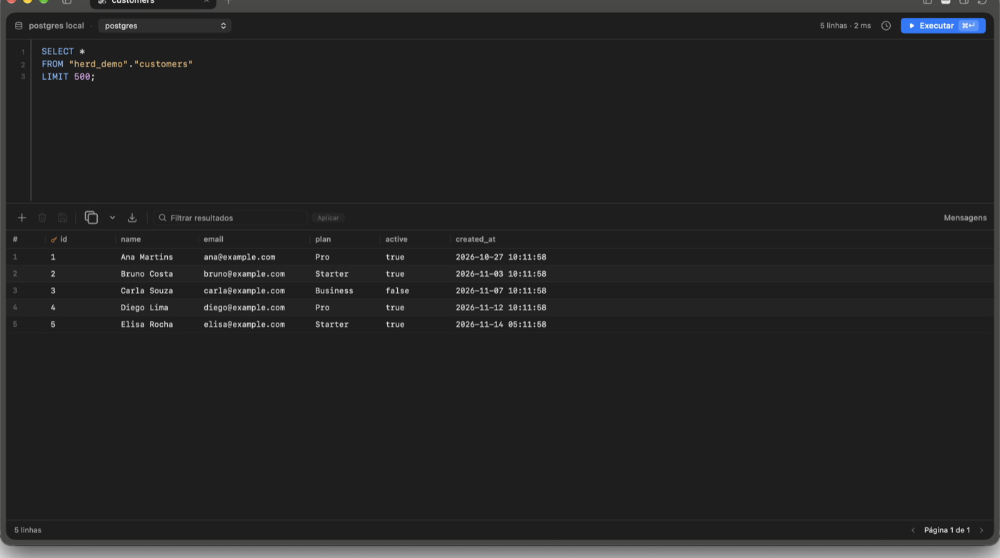
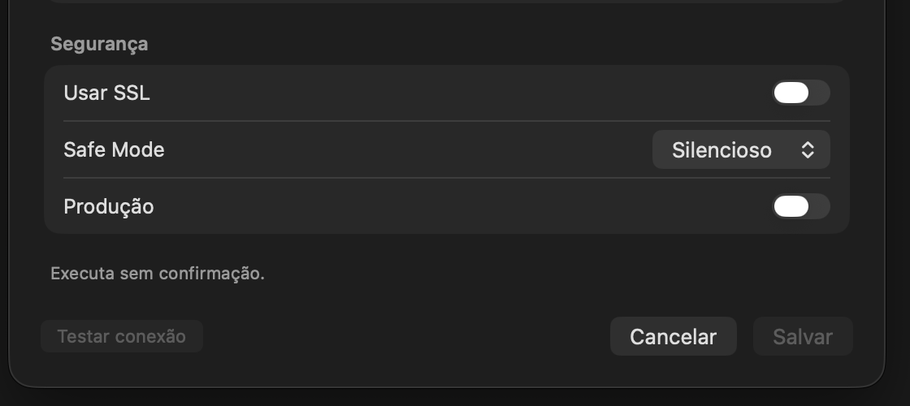

  

<h1 align="center">herd</h1>

<strong>Seus bancos de dados, com a leveza do Mac.</strong>

  Um cliente PostgreSQL e SQL Server nativo, rápido e silencioso. 
  Explore schemas, escreva SQL, edite dados e faça backup — tudo na mesma janela.

  Nativo para macOS &nbsp;·&nbsp; Interface em português 
  PostgreSQL + SQL Server &nbsp;·&nbsp; Senhas no Chaveiro &nbsp;·&nbsp; Sem telemetria

  

## Menos janelas. Menos espera. Mais banco de dados.

O herd reúne árvore de objetos, editor e resultados em uma janela rápida e silenciosa. Ele abre em segundos, acompanha o tema do sistema e mantém tudo o que você precisa à vista.

Sem conta na nuvem. Sem telemetria. Só o seu Mac falando diretamente com o seu banco.

| Nativo de verdade                                                                     | Do schema ao dado                                                                | Privado por padrão                                               |
| :------------------------------------------------------------------------------------ | :------------------------------------------------------------------------------- | :--------------------------------------------------------------- |
| Um app leve, com tema claro e escuro, menus do sistema e atalhos que você já conhece. | Navegue pela estrutura, consulte, edite células e revise o SQL antes de aplicar. | Suas senhas ficam no Chaveiro e as conexões não saem do seu Mac. |

## Tudo à mão, sem sair do fluxo

| Para trabalhar com…     | O herd resolve com…                                                                             |
| :---------------------- | :---------------------------------------------------------------------------------------------- |
| A estrutura do banco    | Árvore sob demanda, filtro instantâneo, visualização da estrutura e assistentes de criação.     |
| Consultas e scripts SQL | Editor com realce de sintaxe, formatação, snippets e sugestões enquanto você digita.            |
| Os dados da tabela      | Edição direta na célula, inclusão e remoção de linhas, revisão do SQL e aplicação em transação. |
| Rotinas de operação     | Backup e restore, cópia de segurança salva no Mac e importação/exportação de CSV.               |
| Segurança e privacidade | Senhas no Chaveiro, Safe Mode por conexão e destaque visual de ambientes de produção.           |

## Escreva SQL. Edite dados. Revise antes de aplicar.

Execute o script inteiro, apenas o trecho selecionado ou só o comando sob o cursor. Se algo demorar demais, cancele de verdade — sem fechar a janela nem reiniciar o app. Quando o script retorna várias consultas, cada resultado aparece em seu próprio painel.

Na tabela, edite qualquer célula com dois cliques, adicione linhas navegando pelo teclado e selecione intervalos inteiros com `Shift`. Antes de gravar, veja o SQL que será aplicado e confirme todas as alterações de uma vez.

  

## Conexões seguras, sem burocracia

Cadastre servidores locais ou remotos em segundos, teste a conexão antes de salvar e ative SSL quando precisar. Tudo fica guardado no seu Mac — e as senhas, no Chaveiro do macOS.

  

## Backup e restore em poucos cliques

No PostgreSQL e no SQL Server, o herd conduz o backup e o restore pela interface, com progresso e aviso ao terminar. No SQL Server, você escolhe onde guardar:

| Formato                | Onde fica   | Indicado para                                                     |
| :--------------------- | :---------- | :---------------------------------------------------------------- |
| **Script SQL**         | No seu Mac  | Levar o banco para outro servidor, versionar ou abrir o conteúdo. |
| **Backup do servidor** | No servidor | Rotina de backup do próprio servidor, cópia completa e rápida.    |

O script SQL inclui a estrutura, os dados e os objetos programáveis do banco. O restore recria tudo no destino e pode criar o banco automaticamente. Também é possível fazer backup de uma tabela específica, sem levar o resto do banco.

O herd conecta direto ao SQL Server, sem instalar nada além do app. O login usa usuário e senha do SQL Server; autenticação do Windows e Entra ID ainda não são suportadas.

## Segurança no dia a dia

Escolha, por conexão, como o herd deve se comportar antes de executar algo sensível: silencioso, pedindo confirmação ou exigindo senha ou Touch ID. Conexões de produção ficam destacadas na aba e na barra de título, para você nunca esquecer onde está mexendo.

  

## Feito para o Mac, de verdade

Tema claro e escuro, menus de contexto do sistema, atalhos no padrão do macOS e do VS Code, estados vazios e de erro cuidados e um app que se instala como qualquer programa do Mac. O herd se comporta como parte do sistema — não como um site dentro de uma janela.

- [Atalhos de teclado](docs/ATALHOS.md)

---

Feito para o Mac. Sem conta, sem telemetria.

