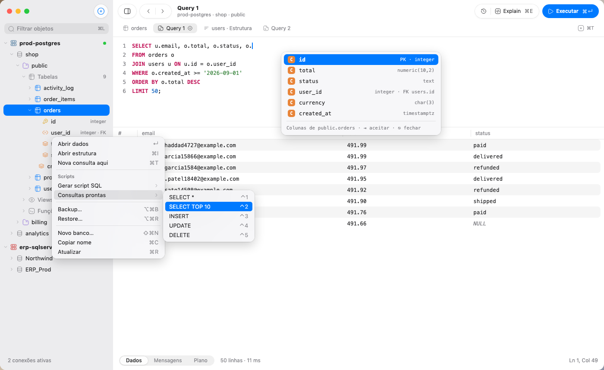

# herd-db

Gerenciador de bancos nativo para macOS — PostgreSQL agora, SQL Server na fase 6.
Interface em português, SwiftUI + AppKit, sem Electron.



**Estado:** fases 1 e 2 concluídas. Próxima: fase 3 (autocomplete, snippets e consultas prontas).

## Roadmap

| Fase | Escopo | Status |
| --- | --- | --- |
| 1 | Esqueleto, driver PostgreSQL, conexões e árvore | ✅ Concluída |
| 2 | Editor SQL, execução, cancelamento e histórico | ✅ Concluída |
| 3 | Autocomplete, snippets e consultas prontas | ⏳ Próxima |
| 4 | Grid de dados com paginação, filtro e edição inline | Pendente |
| 5 | Structure/DDL | Pendente |
| 6 | FreeTDS + SQL Server | Pendente |
| 7 | Backup/restore, novo banco e geração de scripts | Pendente |
| 8 | Polimento, acessibilidade e empacotamento | 🚧 Parcial |

## Plano detalhado por fases

### Fase 1 — Esqueleto, driver PostgreSQL e árvore ✅

- [x] Pacote SwiftPM com `HerdCore` (sem UI), `HerdDB` (app) e testes
- [x] Janela nativa com `NavigationSplitView`, sidebar estilo pgAdmin e abas de consulta
- [x] Tema claro/escuro automático e componentes 100% do sistema
- [x] Protocolo `DatabaseDriver` async + `SQLDialect` (quoting, `LIMIT`/`TOP`)
- [x] `PostgresDriver` com `postgres-nio` e pool por conexão
- [x] Descoberta de bancos, schemas, tabelas, views, colunas, PKs e FKs
- [x] Árvore conexão → banco → schema → tabela/view → coluna, com carga sob demanda
- [x] Filtro de objetos, seleção e menu de contexto nativo por tipo de nó
- [x] Gerenciador de conexões: JSON em Application Support, senha no Chaveiro, teste de conexão

### Fase 2 — Aba de consulta ✅

- [x] Editor SQL em `NSTextView`/TextKit 1 com placeholder de atalho
- [x] Realce de sintaxe próprio (keywords, strings, números, comentários e parâmetros)
- [x] Números de linha, indentação automática, Tab em 4 espaços, sem smart quotes/spell check
- [x] Separação de scripts em comandos e ranges (`SQLStatementSplitter`)
- [x] Execução sequencial de vários comandos; erro indica "Comando X de Y"
- [x] `⌘↵` executa script ou seleção; `⌥⌘↵` executa seleção ou comando sob o cursor
- [x] `⇧⌘↵` executa o script inteiro ignorando a seleção
- [x] Cancelamento real via `pg_cancel_backend` em conexão reservada do pool
- [x] Resultados com todos os conjuntos retornados, tempo, contagem de linhas e erros
- [x] Abas com banco, estado de execução e menu de contexto (fechar/copiar SQL)
- [x] Histórico por conexão/banco no inspetor: horário, duração, linhas, erro, reuso e limpeza
- [x] 51 testes: splitter (21), tokenizer (11), histórico (7), dialeto (4), conexões (2)
      e integração Postgres (6)

### Fase 3 — Autocomplete, snippets e consultas prontas

- [ ] Parser leve de contexto (`FROM`/`JOIN`, `alias.`, `schema.`)
- [ ] Popup de sugestões com schemas, tabelas e colunas, filtrável e navegável por teclado
- [ ] Snippets `sel`, `ins`, `upd`, `del`, `selt`
- [ ] Menu "Consultas prontas" no nó da tabela: SELECT, SELECT TOP 10, INSERT, UPDATE, DELETE
- [ ] Consulta pronta aberta em nova aba com o SQL preenchido

### Fase 4 — Grid de dados

- [ ] Grid virtualizado (`NSTableView`) com linhas alternadas e cabeçalho nativo
- [ ] Paginação de 500 linhas com navegação
- [ ] Ordenação e filtro executados no servidor
- [ ] Edição inline com destaque das células alteradas
- [ ] Geração de `UPDATE ... WHERE <pk>` e sheet "Revisar SQL"
- [ ] Execução em transação, salvar e descartar alterações
- [ ] FK clicável para abrir a linha referenciada
- [ ] Atalhos `⌘S`, `⌘Z`, `⌘D`, `⌘⌫` e `⌘F`

### Fase 5 — Structure/DDL

- [ ] Aba Structure com colunas, índices e chaves estrangeiras
- [ ] DDL gerado (`CREATE TABLE`, índices, constraints)
- [ ] Alterações via preview de `ALTER`
- [ ] Atalho `⌘I`

### Fase 6 — SQL Server

- [ ] FreeTDS (dblib) compilado como xcframework e embutido no `.app`
- [ ] `MSSQLDriver` async com pool e cancelamento
- [ ] Dialeto `[x]`/`TOP` e catálogos do SQL Server
- [ ] Paridade: árvore, abas, execução, resultados e histórico
- [ ] Testes contra SQL Server em Docker

### Fase 7 — Backup, restore, novo banco e scripts

- [ ] Backup/restore PostgreSQL com `pg_dump`/`pg_restore`, progresso e log
- [ ] Backup/restore SQL Server via `BACKUP DATABASE`/`RESTORE DATABASE`
- [ ] Novo banco pela interface
- [ ] Gerar script CREATE/INSERT/UPDATE/DELETE/SELECT pelo menu da tabela
- [ ] Copiar nome do objeto e atualizar nó

### Fase 8 — Polimento e empacotamento

- [x] Ícone do app claro/escuro e ícones IconMCP na interface
- [x] Barra de título compacta e janela com visual nativo (liquid glass)
- [x] Menus de contexto 100% nativos, sem menus desenhados à mão
- [x] `scripts/build-app.sh` com bundle, ícones e assinatura ad-hoc
- [ ] Estados vazios, de erro e de carregamento definitivos em todas as telas
- [ ] Atalhos restantes (`⌘E`, `⇧⌘F`, `⌘/`, `⌘1…9`, `⌥⌘N`, `⌥⌘B/R`)
- [ ] Revisão de acessibilidade
- [ ] Notarização e distribuição

## Limitações atuais

- SQL Server aparece na lista de tipos como "em breve" e não conecta.
- Resultados limitados a 20 000 linhas em memória; a UI mostra as primeiras 1 000 de cada conjunto.
- Grid somente leitura; edição inline, paginação e filtro chegam na fase 4.
- Sem autocomplete, snippets ou consultas prontas ainda (fase 3).
- Histórico limitado a 200 entradas por conexão/banco.

## Requisitos

- macOS 26 ou superior
- Xcode 26 / Swift 6.3
- PostgreSQL local ou remoto para testar (opcional)

## Como rodar

```bash
scripts/run.sh          # compila em release, monta dist/herd.app e abre
```

Ou, separadamente:

```bash
scripts/build-app.sh    # gera dist/herd.app
open dist/herd.app
```

Na primeira execução, clique em **+** na sidebar para cadastrar uma conexão.

## Testes

```bash
swift test
```

O teste de integração com o Postgres fica desligado por padrão. Para rodá-lo contra
um servidor local (usuário atual, banco `postgres`, porta 5432):

```bash
HERD_TEST_PG=1 swift test --filter PostgresDriverTests
```

## Estrutura

```
Sources/
  HerdCore/                 biblioteca sem UI
    Models.swift            ConnectionConfig, DatabaseInfo, TableInfo, ColumnInfo, QueryResult
    SQLDialect.swift        quoting e LIMIT/TOP por engine
    DatabaseDriver.swift    protocolo async que todo driver implementa
    Postgres/PostgresDriver.swift  driver postgres-nio + formatação de células
    DriverRegistry.swift    um driver por conexão, compartilhado pelas janelas
    ConnectionStore.swift   JSON em Application Support
    Keychain.swift          senhas no Chaveiro
    SQLStatementSplitter.swift  separação de scripts em comandos e ranges
    SQLTokenizer.swift      tokens para realce de sintaxe
    QueryHistoryStore.swift histórico persistido por conexão/banco
  HerdDB/                   app SwiftUI
    HerdDBApp.swift         entrada, cena e menus
    AppModel.swift          estado global (conexões + drivers)
    WorkspaceState.swift    abas, seleção, sheets, execução/cancelamento
    ObjectTreeModel.swift   árvore lazy, filtro, seleção, reload
    QueryTab.swift          estado de uma aba
    UI/                     MainWindow, SidebarView, DetailView, QueryTabView,
                            QueryResultsView, SQLEditorView, ConnectionSheet
Resources/Info.plist        bundle id, versão, mínimo do sistema
scripts/build-app.sh        build release + bundle + assinatura ad-hoc
scripts/run.sh              build + open
docs/mockups/               referências visuais do projeto
```

## Onde ficam os dados

- Conexões: `~/Library/Application Support/herd-db/connections.json` (modo `0600`)
- Senhas: Chaveiro do macOS, serviço `com.juniorsilva.herd-db`, conta = UUID da conexão
- Histórico: `~/Library/Application Support/herd-db/history.json` (modo `0600`)
